# Anamnesis

**What the patient says vs. what's on the pack.**

The patient sends a voice note and photos of their medicine packs. The clinician gets a one-page brief. [1.1] Every finding links back to the audio turn and the image region it came from. [1.3]

Built for the Meta Global AI Developer Hackathon. Track: Indie. Also entered for two bonus prizes: Best Agentic Use-Case and Best Build on Meta Open Weight Models. [6.4]

All the code, tests and evidence here were written during the hackathon: the history starts with the first commit on 27 Oct 2026, 10:34 CET. [5.8]

Anamnesis gives no medical advice, and every run so far is a staged test, not clinical use. [1.15]

Numbers in brackets, such as [4.13], are rows of [`docs/CLAIMS.md`](docs/CLAIMS.md). Each row gives a claim's evidence by file and line, and the words the claim may use.

## Why
**The ingestion problem.** The record is often wrong about what patients take. [6.5]

- **Outpatients.** In an outpatient practice, comparing what patients take (their medicine bottles) with the doctor's record, 239 patients (76%) had at least one discrepancy. Of the 545 discrepancies, 51% were medicines taken but not recorded, 29% recorded but not taken, and 20% a different dose. [6.5]
- **At hospital admission.** Medication history errors at admission occur in up to 67% of patients (a systematic review of 22 studies and 3,755 patients). In another study, 53.6% of patients (81 of 151) had at least one unintended discrepancy at admission, and 38.6% of the discrepancies could have caused moderate to severe harm. [6.6]
- **A text-only chat can't see the pack.** In a Lancet feasibility study, primary care doctors who read an AI pre-visit chat said it helped them prepare in 33 of 44 cases. But that text-only chat can't see the pack. The study enrolled 114 patients, and 98 completed the chat and the visit. [6.2]

These are the studies' numbers, not Anamnesis's. Anamnesis measured none of them. [6.5, 6.6, 6.2]

**What Anamnesis does about it.** Plain code compares what the patient said, as extracted, with what the reader read from the label, and no model decides a finding. [1.16] Every finding links back to the audio turn and the image region it came from. [1.3] The brief stays a draft until the clinician approves it, and the clinician decides the pause. [2.2, 2.3]

<sub>Bedell SE et al. Discrepancies in the use of medications: their extent and predictors in an outpatient practice. *Arch Intern Med* 2000;160(14):2129–34. [doi:10.1001/archinte.160.14.2129](https://doi.org/10.1001/archinte.160.14.2129)<br>
Tam VC et al. Frequency, type and clinical importance of medication history errors at admission to hospital: a systematic review. *CMAJ* 2005;173(5):510–5. [doi:10.1503/cmaj.045311](https://doi.org/10.1503/cmaj.045311)<br>
Cornish PL et al. Unintended medication discrepancies at the time of hospital admission. *Arch Intern Med* 2005;165(4):424–9. [doi:10.1001/archinte.165.4.424](https://doi.org/10.1001/archinte.165.4.424)<br>
Brodeur PG et al. Conversational diagnostic artificial intelligence in ambulatory primary care: a prospective feasibility study. *Lancet* 2026;408(10565):1732–44. [doi:10.1016/S0140-6736(26)01535-7](https://doi.org/10.1016/S0140-6736%2826%2901535-7)</sub>

## At a glance
Every number below has its n and its misses further down. These are staged tests, not a validation. [4.15] Each hero set stands alone: the sets ran on different code and are never added together, and none of them showed a harmful finding.

| What | Result | n, and the catch | Rows |
|---|---|---|---|
| The Spanish hero: 10 mg of bisoprolol said against a 5 mg Emconcor box, and metoprolol against a Lopresor 100 mg box, on images from Spain's medicines registry | **9 of 10** in the third pre-registered set (the boxes cropped to their front, the generic names said); 3 of 10 and 4 of 10 in the first two sets. 0 harmful in each set | n = 10 per set, one synthetic Spanish voice; the earlier misses came from the media: the note's first words lost, uncropped images read partial, the brand Emconcor misheard | [4.30] |
| The first hero (U12): Concor 10 mg said against a 5 mg box, and Beloc-Zok against a Bloxazoc box | **9 of 10 on the final code** (31 Oct), scored with the system's own categories; 0 of 10 as registered. Earlier sets, scored the same way: 10 of 10 on batch 27's code (31 Oct), 1 of 1 on batch 24.1's code from a fresh clone (30 Oct), and 6 of 10 on batch 23.1's code (28–29 Oct). 0 harmful in each set | n = 10 per set (1 in the clone set), one synthetic voice; the registered key named the wrong category for Concor; on the final code, run 9 abstained because the reader gave no strength | [4.29, 4.22, 4.28, 4.5] |
| The follow-up by itself, live on U11: one public pack photographed twice | Anamnesis asked for the ibuprofen photo by itself in 4 of 4 runs and left the unreadable pack to the clinician. **Matched in 2 of 4**; in the other 2 the reader marked the new photo partial, so it asked once more, and the brief waits on the patient | n = 4, one synthetic voice; the registered run is one of the two that didn't match; the patient's replies are scripted | [2.8, 2.7] |
| Ten public pack photos | 1 of 10 right before batch 21, 3 of 10 after. No false match, and no wrong strength or ingredient shown as fact | 10 cases, one run per pass. Seven cases miss in both runs: U2, U5, U6, U7, U8, U9 and U10 | [4.11] |
| Ten invented traps for the relation checks | Before batch 27, 7 of the 10 would have been shown as fact if a model had made them, 3 as false matches. After it, 0. Live, 20 calls (one per trap and model, on invented text): none showed a wrong finding as fact after batch 27.1 | In the live calls Spark 1.3 never made one of these errors: on every trap it was right or abstained. Word rules, not understanding | [4.23, 1.22] |
| The same eight cases, with open weights inside the intake | 1 to 5 of 8 per column; with a second reader, 10 of 16 runs right, against 8 of 16 for the same runs without it. No harmful finding in any column | 8 cases per column, one run each; the second-reader comparison is 8 cases × 2 runs. A case or two can be chance | [4.20, 4.21] |
| A tuned Muse Glimmer 30B, an optional claim extractor | 290 of 303 generated test notes fully right with no harmful claim. Spark 1.3 with the 29 Oct prompt got 203; with today's prompt it got 200 with 3 counted harmful as pre-registered, or 203 with 0 under a second view | Generated text, one training run; the tuned model learned the key's conventions | [4.18, 4.26] |
| Label reading, zero-shot, on the 20 crops SAM found | Spark 1.3 and Muse Spark Open on Baseten: 13 and 13 correct as first scored (3 and 2 harmful), and 14 and 14 after a scorer fix made after the run (2 and 1 harmful). Spark Open on Fireworks with strict JSON mode: 1 correct (0 as first scored) | Descriptive, n = 20; SAM found a pack in only 20 of 39 photos; Fireworks' JSON mode returned no strength | [4.13] |

## How it works

```mermaid
flowchart LR
    voice["Voice note"] --> vt["Muse Voice Transcribe:<br/>timed turns"]
    vt --> cx["Muse Spark 1.3:<br/>the medicines the patient names<br/>(optional: tuned Muse Glimmer)"]
    photo["Pack photos"] --> clean["Turned upright,<br/>metadata stripped"]
    clean --> sam["SAM 3.1:<br/>marks each pack it finds"]
    sam --> rd["Muse Spark 1.3:<br/>reads each crop,<br/>once more at 2× if it can't"]
    rd -.->|"still unreadable (optional)"| rd2["Muse Spark Open:<br/>one second read"]
    cx --> st["Each amount is kept only if it is said in a cited turn,<br/>and said about that medicine (word rules),<br/>or is printed in the reader's label text"]
    rd --> st
    rd2 -.-> st
    st --> cmp["Plain code compares<br/>the two sides"]
    cmp --> brief["One-page brief:<br/>each finding linked to its turn and crop"]
    brief --> doc{"Clinician"}
    doc -- "asks for one new photo" --> photo
    doc -- "approves" --> signed["Approved brief"]
```

<sub>The diagram restates rows 1.2, 1.3, 1.6, 1.13, 1.16, 1.22, 1.27, 1.28, 2.1, 2.2, 3.1 and 3.6.</sub>

| Step | Decided by |
|---|---|
| The order of the steps | Code. The order is fixed, and no model chooses an action. [2.3] |
| What was said, and what each label prints | Models: Voice Transcribe, SAM 3.1 and Spark 1.3 by default. [1.2] |
| Whether a number or an ingredient a model wrote is kept | Code: the checks below. [1.13, 1.22, 1.23] |
| Whether the two sides agree | Code. No model decides a finding. [1.16] |
| Asking the patient for one new photo, and approving the brief | The clinician. [2.1, 2.2] |

- Muse Voice Transcribe turns the note into timed turns. SAM 3.1 marks each pack it finds. Muse Spark 1.3 picks the medicines out of the transcript and reads each label. [1.2]
- Before any model sees a photo, Anamnesis turns it upright and strips its metadata, GPS included. [3.1]
- The label reader only ever sees the crop of its own box. [1.6]
- A number a model writes is kept only if it appears in the patient's turns or in the label text the reader returned. [1.13] An ingredient a model writes for a claim is dropped unless the patient's turn says it, or a close form of it. [1.23]
- After that check, word rules look at what each amount was said about: a negation ("ten, not five"), another unit, a tablet count, another medicine's amount, a past amount, a split daily total and a duration. An amount that fails a rule is dropped. They are word rules, not understanding, and their limits are under Limitations. [1.22]
- When a pack prints a strength per a volume, such as 250 mg per 5 ml, a reading keeps that strength only if the pack also prints it in the reading's own unit, such as per ml. Otherwise the strength is left empty. It is built to lose a strength rather than keep a wrong one, and its known exceptions are under Limitations. [1.19]
- A combination such as Augmentin 875/125 is read as its set of ingredients, and a catalogue name counts only when it covers all of them. [1.24]
- Then plain code compares the two sides. No model decides a finding. [1.16]
- When the reader reports a label unreadable or partial, Anamnesis says so. [1.17] If a photo shows no pack, the brief says so. [1.12]
- Every product model call is logged with its cost, and each live intake has a call cap and a dollar cap. [3.5]

## The brief
- Disagreements come first, with what the patient said, as extracted, and the pack side by side. [1.7]
- Click a turn and you hear that turn, from its start to its end. [1.4] Click the box and you see the crop the label reader saw. [1.5]
- Every sentence Anamnesis adds is fixed text. It adds no advice of its own, and pack text is quoted as printed. [1.8]
- Panadol and Gelocatil are two brand names for one medicine. Anamnesis notes that both contain paracetamol, and that concurrent use is unconfirmed. [1.9] It also notes two medicines from one class, beta-blockers. Concurrent use is unconfirmed. [1.10]
- Only what the patient says counts as use. A photo of a pack never does. [1.11]
- Where the catalogue knows a medicine, the brief shows its WHO ATC code and its RxNorm ids, with a reference line that points to `NOTICE`, and no codes beside a side that contradicts its own name. [1.25]
- The brief is one static page. It calls no model, and it refuses media the report wasn't made from. [1.14] Its layout fits a phone-width screen, checked in browser emulation and not on a phone. [1.26]
- Every brief ends with a collapsed "How it got here" table: one row per agent step, with its model, tokens, time and cost, and a total with the intake's calls and spend. [1.20]

## The clinician's pause, and the follow-up by itself
- If a label can't be read, the clinician can ask the patient for one new photo. Only that photo is processed, and the brief updates. The run pauses for a person, then resumes. [2.1]
- The brief stays a draft until the clinician approves it. [2.2]
- The code fixes the order. The clinician decides the pause. No model chooses an action. [2.3]
- The clinician's pause ran live once, on a phone photo from a public dataset: the first photo read as partial, the clinician asked for one new photo, and with the second photo the brief showed a match. It was one run, with a synthetic voice note. [2.5] There is no clinician app yet: the request is one function call, and in the demo the developer plays the clinician. [2.6]
- Anamnesis can also run the follow-up by itself. After the intake, it asks the patient for a photo of each medicine they mentioned but didn't photograph, with a fixed message that names the medicine. It takes the replies, reads only the new photos, and stops when nothing is left to ask or after two rounds. A pack that couldn't be read stays with the clinician, and the brief stays a draft until the clinician approves it. Code fixes what to ask, in what order and when to stop: no model chooses an action. [2.7, 2.3]
- The follow-up ran live four times on U11, one public pack photographed twice, with a synthetic voice note. Each time, Anamnesis asked for the ibuprofen photo by itself and left the unreadable first pack to the clinician. In 2 of 4 runs the new photo read and the brief showed a match. In the other 2 the reader marked it partial, so Anamnesis asked once more, and the brief waits on the patient. [2.8] There is no patient app yet: the replies come through a function, and in the demo the developer plays the patient. [2.6, 2.7]

## What runs by default, and what is optional
- By default, the intake runs Meta-hosted Muse Spark 1.3 for the claims and for the labels. [1.21]
- There is no app or server: the intake is a library, `run_intake`, with `scripts/intake_live.py` as its live runner. [1.21]
- Two open-weight steps are optional, each behind a flag of the live script and off by default. A tuned Muse Glimmer 30B can extract the claims, and its answers go through every product check, as Spark's do. [1.28] Muse Spark Open can read the labels, or read once more a pack that Spark 1.3 still can't read after its 2× zoom; the second reading counts only if it is readable, is for the same region and keeps everything the first reading had. [1.27]
- Their results are below, beside the default path's. [4.18, 4.20, 4.21]

## Results, as measured
These are staged tests, not a validation. The expected results come first, and every run is reported as it came out, failures included. [4.15] No patient data: the pack photos are rendered test images or public photos of real packs, the patients' histories are invented, and every voice so far is synthetic. [3.3]

Each result names the code it ran on, and later batches haven't rerun every earlier result. The pause and the first hero's first ten ran on batch 23.1's code (28–29 Oct). The first hero's batch 27 ten ran on batch 27's code, and its final ten on the final code, the code of the `demo-freeze` tag (both 31 Oct); batches 27.1, 28, 29 and 30 merged between those two. Ten public photos ran on batches 1–20 and on batch 21, and the label-reader comparison on batch 22's code. Batch 23's changes, the "package" concept and the volume rule, haven't been rerun on the comparison. The follow-up's four runs and the Spanish hero's three sets ran on batch 31's code (1 Nov), merged after the freeze. [2.5, 4.5, 4.22, 4.29, 4.11, 4.13, 4.14, 1.19, 2.8, 4.30]

### The Spanish hero, in three sets
Three pre-registered sets of ten on 1 Nov, all on batch 31's code. They use two official pack images from Spain's medicines registry, AEMPS CIMA (Emconcor Cor 5 mg and Lopresor 100 mg), and a synthetic Spanish voice note. Only the media changed between the sets. [4.30]

| Set | What changed | All three findings | Harmful |
|---|---|---|---|
| 1 | "Tomo Emconcor diez miligramos cada mañana y metoprolol cien miligramos dos veces al día", with the images as the registry publishes them | 3 of 10 | 0 |
| 2 | 0.8 s of silence before the note, and each image cropped to its box's front | 4 of 10 | 0 |
| 3 | The patient says "bisoprolol" instead of "Emconcor" | **9 of 10** | 0 |

- **The causes:**
  - In set 1, the note's first words were lost in every run, and the reader marked an uncropped image partial in 4 runs.
  - In set 2, the crops read in 20 of 20, but the brand Emconcor came back as the catalogued "Concor" in only 4 runs. Otherwise it came back as "Cocor", "Koncor" or "Korcor", in Arabic script, or not at all.
  - In set 3, the one miss was a repeated "dos miligramos" read as a 2 mg intake: a false disagreement, not a false match.
- **What the numbers are:** one synthetic voice, two registry images and n = 10 per set, so they describe the runs, not rates. The sets are never added together. The details are in [`evidence/diagnostics/hero-es-2026-11-01/results.md`](evidence/diagnostics/hero-es-2026-11-01/results.md). [4.30]

### The first hero (U12), in four sets of runs
We ran the first hero case in four separate sets, and the sets are never added together. The latest, ten runs on the final code (the `demo-freeze` tag, 31 Oct, 20:02–20:08 CET), gave **9 of 10** with the system's own categories and 0 of 10 as registered. No set showed a harmful finding: no false match and no wrong strength. [4.29, 4.22, 4.28, 4.5]

| Set | Code | As registered on 28 Oct (Concor `strength_mismatch`) | With the system's own categories, decided after the first ten |
|---|---|---|---|
| Final ten: 10 runs, 31 Oct, 20:02–20:08 CET | the final code (`demo-freeze`) | 0 of 10 | **9 of 10** |
| Batch 27 ten: 10 runs, 31 Oct, 12:48–12:54 CET | batch 27's code | 0 of 10 | 10 of 10 |
| Clone run: 1 run, 30 Oct, 00:14 CET, from a fresh clone of the first freeze tag | batch 24.1's code | 0 of 1 | 1 of 1 |
| First ten: 10 runs, 28–29 Oct | batch 23.1's code | 0 of 10 | 6 of 10 |

- **The case:** two public photos, a Concor 5 mg box and a Bloxazoc 50 mg box, and a synthetic note: "I take Concor ten milligrams every morning, and Beloc-Zok fifty milligrams twice a day." Pre-registered before the first call. [4.10, 4.5]
- **The registered key expected a different category.** For Concor it expected `strength_mismatch`, but the note states an intake, so the system reports `intake_differs_from_unit_strength`: 10 mg taken against a 5 mg tablet. The key was written wrong and stays as written, so the registered score is 0 in every set. [4.5, 4.10]
- **With the system's own categories,** a run counts when all three findings appear: Concor's 10 mg flagged against the 5 mg box, Beloc-Zok matched to the Bloxazoc box (both are metoprolol), and the beta-blocker note. [4.5, 4.10, 4.29]
- **On the final code,** Concor's dose and the beta-blocker note were right in 10 of 10 runs. Run 9 is the miss, on the label side: the reader marked the Bloxazoc crop readable and gave its ingredient, metoprolol, but no strength, though its label text begins "Bloxazoc® 50 mg". With nothing to compare against the 50 mg said, the pair abstained (`insufficient_information`). [4.29]
- **Why the first ten missed.** In r10 "BelocZokZok" didn't resolve, which started on the speech side. In r01, r05 and r09 both claims came back without amounts. r05's and r09's transcripts are word for word the same as r02's and r07's, which kept their amounts, so speech wasn't their cause; r01's ("ten ten") has no twin. Afterwards, sending r05's transcript to Spark 1.3 ten times gave three replies of the kind batch 24 now handles: two empty strength objects and one "null" label. The runs' own replies weren't kept, so that is an inference, not proof. [4.5]
- **Between the sets, the code changed** (batch 24's fix, then batch 27, then batches 27.1 to 30), but each set is n = 10 with one synthetic voice and two public photos: the sets describe those runs, not a trend and not human speech. 6 of 10 against 10 of 10 could be chance (Fisher's exact test, two-sided p = 0.087), and one label-side miss in ten is within run-to-run variation. Transcription still repeats words (five of the batch 27 ten and two of the final ten did), and none of those repeats cost a finding. [4.22, 4.29]
- About 4 cents and 29–48 s a run. [4.2, 4.9, 4.28, 4.29]
- Every run and cause: [`u11-u12.md`](evidence/batches/21/u11-u12.md) for the first ten, [`results.md`](evidence/diagnostics/hero-claims-2026-10-31/results.md) for the batch 27 ten, [`results.md`](evidence/diagnostics/hero-final-2026-10-31/results.md) for the final ten.

<details>
<summary>The first ten, run by run</summary>

| Runs | Concor (10 mg said, 5 mg box) | Beloc-Zok (50 mg said, Bloxazoc 50 mg box) | Beta-blocker note |
|---|---|---|---|
| r02, r03, r04, r06, r07, r08 | `intake_differs_from_unit_strength` | `match` | yes |
| r01, r05, r09 | `insufficient_information` | `insufficient_information` | yes |
| r10 | `intake_differs_from_unit_strength` | `unresolved_name` ("BelocZokZok") | no |

Voice Transcribe returned 7 different transcripts of the one file, with a word or number repeated in 7 runs ("ten ten", "BelocZokZok"). [4.5]

</details>

### Ten public pack photos, before and after batch 21
The expected results were committed before the first run (8b993ff). [4.4] On the same ten pre-registered public-photo cases, with the same expected results, the code got 1 right before batch 21 and 3 after it. Neither run showed a false match, or a wrong strength or ingredient as fact. Seven cases miss in both runs: U2, U5, U6, U7, U8, U9 and U10. [4.11]

<details>
<summary>Every case, before and after batch 21</summary>

| Case | Expected | Before batch 21 | After batch 21 |
|---|---|---|---|
| U1 Concor, Russia (Cyrillic) | `match` | `insufficient_information` | `match` ✓ |
| U2 Augmentin, Belgium (French) | `match` | not paired | `insufficient_information`: the claim came back with no strength |
| U3 Panadol, Australia | `match` | `insufficient_information` | `match` ✓ |
| U4 Panadol 500 mg, Finland, two tablets | `intake_differs_from_unit_strength` | ✓ | ✓ |
| U5 Norvasc 5 mg and 10 mg, Israel | paired with the 5 mg box, `match` | paired with the 10 mg box | paired with the 10 mg box, `insufficient_information`: a wrong pairing |
| U6 Glucophage, China | `match` | `unresolved_name` | the same: the reader transcribed the manufacturer block |
| U7 Sortis 40 mg vs "Lipitor twenty milligrams" | `strength_mismatch` | `insufficient_information` | `unreadable_source`: the pack read as only partly readable (not harmful) |
| U8 Betaloc ZOK 100 | `match` | `unreadable_source` | the same: low resolution, the unit cut off (not harmful) |
| U9 Panadol Extra carton | `ingredient_mismatch` | no pack found | the same: SAM finds no pack in flat label artwork |
| U10 Panadol Extra Strength 500 | `match` | no pack found | the same |

</details>

- **U5 is still a miss.** The patient's Norvasc is paired with the 10 mg box instead of the 5 mg one, and the brief says it can't confirm agreement. [4.11] Before batch 21, the claim tied with both boxes and the tie went by id. Batch 21 lets the patient's stated dose break such a tie, but in its run the claim and the 5 mg box both came back without amounts, so the two boxes tied again. Spark still sometimes writes an amount as a word, and on batch 21's code that word was dropped. [4.11, 1.13]
- **U7 is a miss in both runs.** Its expected result was written wrong: it assumed the patient stated a strength, but Spark read "Lipitor twenty milligrams" as an intake. The expected result is kept as written. [4.11]
- These two runs are the scope of the "no false match" line. In the comparison below, Spark 1.3 showed a wrong strength as fact on 2 of 20 crops. [4.11]
- Later runs of the same cases are in their own columns under Open weights. [4.11, 4.20]
- Every case, cause and cost: [`evidence/batches/21/live-after.md`](evidence/batches/21/live-after.md).

### Ten invented traps for the relation checks
A claim can pass the value check and still be wrong about what a number was said about. We wrote ten invented traps over eight patterns, each a wrong reply a model could give: a negated amount (in English and in Arabic), a past amount, another medicine's amount (in the same turn and in another), a tablet count read as milligrams, micrograms written as milligrams, a split daily total, one part of a combination, and a stopped medicine read as active. We ran them offline through the product's checks. [4.23]

- **Before batch 27,** 7 of the 10 would have been shown as fact if a model had made them, and 3 of those as false matches. **After it,** none is. [4.23]
- **Live,** one call per trap on Spark 1.3 and on the tuned Glimmer, 20 calls on invented text: no false match at any point. One call showed a wrong finding as fact before batch 27 and one after it, trap J on the tuned Glimmer, a false disagreement through its tablet count. After batch 27.1, none did: 20 of 20. [4.23]
- The registered expectation for trap J after batch 27 did not hold, and batch 27.1 fixed it. Spark 1.3 got every trap right or abstained at all three points, so the live calls mostly show the models behaving; the offline traps show what the checks do. [4.23]
- Word rules, not understanding: the limits are under Limitations. [1.22]

### Two synthetic voice notes
On two synthetic notes, one English and one Egyptian Arabic, 3 of 6 findings came out as expected before batch 21, and 6 of 6 after it. [4.1, 4.12] The three misses on 28 Oct came from the batch 20 prompt: Spark copied each dose spoken in words ("five") into the amount, the stated-amount rule dropped it, and every such case came out as `insufficient_information`. Batch 21 asks for digits. [1.13, 4.1]

<details>
<summary>Every finding, 27 Oct, 28 Oct and after batch 21</summary>

| Note | Expected | 27 Oct | 28 Oct, before batch 21 | After batch 21 |
|---|---|---|---|---|
| English: Concor "five milligrams once a day" | `match` | ✓ | `insufficient_information` | ✓ |
| English: metoprolol 50 mg twice a day vs Beloc-Zok 100 mg | `intake_differs_from_unit_strength` | ✓ | ✓ | ✓ |
| English: Panadol, stopped | stopped | ✓ | ✓ | ✓ |
| Arabic: كونكور خمسة ملي جرام (Concor, five milligrams) | `match` | ✓ | `insufficient_information` | ✓ |
| Arabic: بيلوك زوك خمسين ملي جرام (Beloc-Zok, fifty milligrams) vs Beloc-Zok 100 mg | `intake_differs_from_unit_strength` | ✓ | `insufficient_information` | ✓ |
| Arabic: البنادول (Panadol), stopped | stopped | ✓ | ✓ | ✓ |

</details>

### Spanish and German
Eight synthetic Spanish and German notes ran live once each in batch 24, with the expected results committed first: 7 of 8 came out as pre-registered. [4.27]

- **S1 missed on the speech side.** Voice Transcribe heard the unknown brand "Emconcor" as the catalogued "Concor". After Emconcor joined the catalogue, it did so again and dropped the amount word. [4.27]
- **G2:** a strength said with "half a tablet" ("eine halbe Tablette Beloc-Zok hundert Milligramm") came back as the intake amount. **G3,** rerun after batch 24.1: the claim came back with no amount though the transcript was exact, and the raw reply isn't saved, so the cause isn't proven. [4.27]
- Two of the seven (G1, G3) count under the pre-registered alternative that the pack is read as partial. n = 8, macOS voices; English and Egyptian Arabic stay the tested core. [4.27]

### Cost and time
About 3 cents per intake (12 live intakes, 28 Oct). [4.2] One intake took 17 to 49 seconds (12 live intakes, 28 Oct). [4.9] The first hero's runs cost about 4 cents each and took 29–48 s. [4.2, 4.9, 4.28, 4.29]

## Open weights
Built with Muse Spark Open, Meta's open-weight model, in a zero-shot comparison, in full-intake runs as its label reader, and as an optional reader. The default path stays Meta-hosted Muse Spark 1.3, and the tuned Muse Glimmer 30B is an optional claim extractor. [1.21, 4.13, 4.16, 1.28]

### A tuned Muse Glimmer 30B, for the claims
**What was trained.** A LoRA (rank 16) on Meta's open-weight Muse Glimmer 30B, for one task: the intake's claim extraction. Transcript turns go in, and claims JSON comes out in the product's own schema. The training data are 1,200 generated notes in English and Egyptian Arabic, with the speech-to-text slips seen on 28 Oct, and every answer is built in code, never by a model. One run on one H100 on Modal took 14 minutes. The plan was committed before any training call. [4.18]

**What was measured.** Notes with every claim exactly right, scored by the product's own parser and checks, the same for all three systems: [4.18]

| System | test_iid (100) | test_shift (120) | test_codeswitch (50) | test_real (33) | All 303 | Harmful claims after the checks |
|---|---|---|---|---|---|---|
| Spark 1.3 (29 Oct prompt), the product's default extractor | 67 | 80 | 31 | 25 | 203 | 0 |
| Muse Glimmer 30B, untuned | 21 | 17 | 6 | 7 | 51 | 0 |
| Muse Glimmer 30B + LoRA r1 | 100 | 113 | 47 | 30 | 290 | 0 |

- **The splits:** test_shift has templates unseen in training and 10 held-out drugs, test_codeswitch mixes Arabic and English heavily, and test_real is 33 transcripts that Voice Transcribe returned for 14 synthetic-voice notes. [4.18]
- **Spark's 203 (29 Oct prompt) was 193 as first scored,** and untuned Glimmer's 51 was 50: batch 24's parser fix, the product's own format, moved them. Before that fix, harmful claims after the checks were 1 for Spark 1.3 and 54 for untuned Glimmer. [4.18]
- **What the tuned model learned** is the key's conventions: the clean name instead of the copied speech slip (21 of Spark's field misses), null instead of false for an unsaid as-needed (25) and null instead of an empty strength object (23 intakes the parser dropped). A gain on those is the output format learned, not a measure of hearing, and a parser change alone gave Spark 10 more notes. How much of the rest of the gap is format and how much is the model wasn't separated. [4.18]
- **Its 13 misses, none harmful:** 7 in test_shift (three are cuts of one held-out brand, Inzirqo), 3 in test_codeswitch, and 3 in test_real: U2's "Augmentin 875 and 125", read as an 875 mg intake. [4.18]
- **Spanish brands (r2).** On 60 notes that say 19 Spanish brands neither tuned run was trained on, r2 (trained with 80 other Spanish names added) was fully right on 56, r1 on 55, Spark 1.3 (29 Oct prompt) on 40 (37 with today's prompt) and untuned Glimmer on 11. Adding the Spanish names changed nothing measurable, so r1 stays the headline. n = 60, one run each. [4.19]
- **Spark 1.3 with today's prompt.** After batch 29 added one sentence for combinations, Spark was fully right on 200 of the 303 notes as pre-registered (3 counted harmful: three U2 notes, where the brand's own ingredients count against the reply) and on 203 under a second view defined before any call (0 harmful); the 29 Oct prompt scored 203 and 200 on the same two views. 64 notes flipped both ways between the two runs, so the total moved within run-to-run variation. [4.26]
- **Limits:** generated text, and a small real slice with synthetic voices, so this measures the task on generated speech, not human speech. One training run with no tuning, and one reply per note at temperature 1.0. Modal's billing summaries showed $0.00 billed, all credits. [4.18]
- **Read it beside the full intake below,** never alone: with the tuned model extracting, the pre-registered cases gave 3 of 8 with Spark 1.3 reading, 1 of 8 with Spark Open reading (Fireworks timed out) and 5 of 8 once that was fixed, against 4 of 8 for Spark 1.3 doing both steps. [4.20]
- Every miss: [`evidence/finetune/results.md`](evidence/finetune/results.md) and the per-split lists in [`evidence/finetune/runs/`](evidence/finetune/runs/).

### The full intake with open weights inside it (U1–U8)
The same eight pre-registered public-photo cases, run through the whole intake at different times, on different code and with different models. Each row is one run per case (two runs for the second-reader row), scored by the same script against the expected results committed on 28 Oct. [4.11, 4.16, 4.20, 4.21, 4.24]

| Run | Claims by | Labels by | Right | Harmful |
|---|---|---|---|---|
| 28 Oct, batch 21 | Spark 1.3 | Spark 1.3 | 3 of 8 | 0 |
| 28 Oct, batch 23.1 | Spark 1.3 | Spark 1.3 | 3 of 8 | 0 |
| 28 Oct, batch 23.1 | Spark 1.3 | Spark Open on Baseten | 4 of 8 | 0 |
| 30 Oct, batch 26 | Spark 1.3 | Spark 1.3 | 4 of 8 | 0 |
| 30 Oct, batch 26 | tuned Glimmer | Spark 1.3 | 3 of 8 | 0 |
| 30 Oct, batch 26 | tuned Glimmer | Spark Open on Fireworks | 1 of 8: Fireworks timed out on 7 of the 8 intakes | 0 |
| 30 Oct, batch 26.1 | tuned Glimmer | Spark Open on Fireworks, low effort | 5 of 8 | 0 |
| 31 Oct, batch 27 | Spark 1.3 | Spark 1.3 | 3 of 8 | 0 |
| 31 Oct, batch 28, two runs | Spark 1.3 | Spark 1.3, then Spark Open on Fireworks for any pack still unread | 5 of 8 and 5 of 8 | 0 |
| The same two runs, each recovered pack put back to partial | Spark 1.3 | Spark 1.3 | 4 of 8 and 4 of 8 | 0 |

- **n = 8 cases and one run per row (two for the second-reader row), so a case or two can be chance.** The default path alone scored 3, 3, 4 and 3 of 8 on four runs. Don't rank one row above another. [4.20, 4.11, 4.16, 4.24]
- **The 1-of-8 row stays in the table as run.** Fireworks timed out at the reader's 60 s limit because the reader sent no reasoning effort, so Spark Open reasoned at its default, `xhigh`. Batch 26.1 asks for `low`, and the 5-of-8 row, run the same night, stayed inside the limit. The 1-of-8 row therefore measures the host's latency, not Spark Open's reading. [4.20]
- **The tuned Glimmer's claims** were the same as Spark 1.3's on 7 of 8 cases (the same name, amount and unit), and its claim requests took 4.3–7.0 s against 10.2–22.4 s. [4.20, 4.9]
- **The second reader's whole effect is U7,** in both runs: Spark 1.3 read the Sortis 40 mg box as unreadable even after its zoom, Spark Open read it from the same crop, and the case gave the expected finding. The "without" rows replay the same runs and aren't separate runs. [4.21]
- **The misses and their causes.** U6 is `unresolved_name` in every row: the Chinese-only pack never prints the brand. U2: the pack was read in some rows, but the claim came back without its amounts (or, for the tuned Glimmer, with "875 mg" as the whole intake, the risk written down before the run). U8 is read as partial in most rows. U1's one-case gap on 28 Oct came from the claim extraction, not the reader. U5 paired with the 5 mg box in later rows, on one run each, so it isn't counted as fixed. [4.20, 4.21, 4.24, 4.16, 4.11]
- **U2 (Augmentin 875/125) after batches 29 and 30:** the pack is now read as its two ingredients in 3 of 3 runs. The pair matched in 1 of 3 live runs, against a pre-registered 2 of 3, which was not met. In the other two, Spark 1.3's claim came back without its amounts. Across the live checks since batch 29's prompt, the claim was right in 4 of 6 runs, and in 11 of 11 direct calls. [4.25]
- U9 and U10 were left out of the open-weight rows, because their DailyMed photos may not go to Baseten or Fireworks. [4.16, 3.7]
- Every case and cause: [`evidence/batches/26/intake-plan.md`](evidence/batches/26/intake-plan.md), [`evidence/batches/28/live-results.md`](evidence/batches/28/live-results.md), [`evidence/batches/22/intake-openweight.md`](evidence/batches/22/intake-openweight.md) and [`evidence/batches/30/live-results.md`](evidence/batches/30/live-results.md).

### Muse Spark Open as the label reader: a zero-shot comparison on 39 public photos
In a pre-registered zero-shot comparison, SAM 3.1 found a pack in 20 of 39 public photos. On those 20 crops, as first scored, Spark 1.3 read 13 correctly with 3 harmful readings, and Muse Spark Open on Baseten read 13 with 2. A scorer fix made after the run raised both to 14, with 2 and 1 harmful. [4.13] Every reader read the same SAM 3.1 crops with the same system prompt, schema and parser, and no model was trained. Baseten also got the schema as text in its user message, and Fireworks used strict JSON mode. The photos are 30 Cairo University phone photos (CC BY 4.0) and 9 Wikimedia Commons photos. [4.13]

<sub>Cairo photos: Abdelmaksoud E, Gadallah A, Asad A. Mobile-Captured Pharmaceutical Medication Packages. Mendeley Data, v1, 2022. [doi:10.17632/bjy2svvmn8.1](https://doi.org/10.17632/bjy2svvmn8.1), CC BY 4.0.</sub>

A descriptive comparison from one pass, n = 20: 20 photos of 17 packs, since the Cairo photos come two per pack. Scored after the scorer fix below: [4.13]

| Reader | Correct | Harmful | Missed | Abstained | Error | Cost per read | Median time |
|---|---|---|---|---|---|---|---|
| Muse Spark 1.3 (Meta API) | 14 | 2 | 0 | 4 | 0 | $0.0094 | 7.4 s |
| Muse Spark Open on Baseten | 14 | 1 | 0 | 3 | 2 | $0.0136 | 15.4 s |
| Muse Spark Open on Fireworks, strict JSON mode | 1 | 1 | 10 | 8 | 0 | $0.0100 | 23.4 s |

- **Both scorings.** The scorer splits a combination's ingredients at "+", "/", "&", "and" and "with". Readers also wrote a comma, so the comma was added after the run, which moved four verdicts out of harmful. As run, the three rows were 13 / 3 / 0 / 4 / 0, 13 / 2 / 0 / 3 / 2 and 0 / 3 / 9 / 8 / 0. [4.13]
- **Every harmful reading:** [4.13]
  - Spark 1.3 read Janumet's metformin as 100 mg, where the pack prints 1000 mg. [4.13]
  - Spark 1.3 read a 250 mg/5 ml syrup as "250 mg per dose". [4.13]
  - Spark Open on Baseten read the same syrup as 250 mg per ml, a fivefold error. [4.13]
  - Spark Open on Fireworks put the placeholder "not_printed_in_visible_crop" in a reading's ingredient field. [4.13]
- **Why Fireworks scores low:** its strict JSON mode returned no strength on any crop, so that row measures the host's setting, not the open weights. [4.13]
- **Baseten's 2 errors** were length stops at the 4,000-token limit: no reading, charged, and no wrong reading shown. [4.13]
- **Diagnostics decided after the run, not scores:**
  - With JSON mode off, the same model on Fireworks read 5 of 5 crops that the other two readers had read correctly. [4.13]
  - Read again with an 8,000-token cap, Baseten's two length stops both came back correct. Both replies ended under the old 4,000-token cap, so this was a second draw, not a fix, and the table keeps both as errors. [4.13]
  - In a diagnostic after the run, not pre-registered, the concept "package" found a pack in all 19 photos where the first two concepts found none. With it, Spark 1.3 would have read 22 of the 30 Cairo phone photos correctly, not 7, with one harmful reading: the 250 mg/5 ml syrup's second photo, read as 250 mg per ml. Batch 23 added it to the loop. [4.14]
- The volume rule above was written for the three syrup readings (two in the comparison, one in the diagnostic), but the comparison wasn't rerun on it. [1.19, 4.13, 4.14]
- Every photo, reader and verdict: [`evidence/batches/22/comparison.md`](evidence/batches/22/comparison.md).

<details>
<summary>The 28 Oct full intake, case by case: Spark 1.3 or Spark Open on Baseten reading the labels</summary>

| Case | Expected | Spark 1.3 reads | Spark Open reads |
|---|---|---|---|
| U1 Concor, Russia | `match` | `insufficient_information` | `match` ✓ |
| U2 Augmentin, Belgium | `match` | `unreadable_source`: read as partial | `insufficient_information` |
| U3 Panadol, Australia | `match` | ✓ | ✓ |
| U4 Panadol, Finland, two tablets | `intake_differs_from_unit_strength` | ✓ | ✓ |
| U5 Norvasc 5 mg and 10 mg, Israel | paired with the 5 mg box, `match` | ✓ | ✓ |
| U6 Glucophage, China | `match` | `unresolved_name` | `unresolved_name` |
| U7 Sortis 40 mg vs "Lipitor twenty milligrams" | `strength_mismatch` | `unreadable_source` | `unreadable_source` |
| U8 Betaloc ZOK 100 | `match` | `unreadable_source` | `unreadable_source` |

- **U1 is the one case where the verdicts differ, and the reader didn't cause it.** Both readers read the pack as bisoprolol 5 mg. The claim extraction, Spark 1.3 in both columns, dropped the spoken "five milligrams" in one run and kept it in the other. [4.16]
- **U2 is the one case where the readers differ.** Spark Open read the pack fully, amoxicillin 875 mg + clavulanic acid 125 mg, and Spark 1.3 read it as partial. Both miss U2 on the claim side: the claim came back without its amounts. [4.16]
- With Muse Spark Open as its label reader, the full intake ran end to end on eight pre-registered public-photo cases, once each, with no harmful reading. It got the same correct-or-miss verdict as with Spark 1.3 on seven. $0.56 for the 16 intakes, Meta $0.37 and Baseten $0.19. [4.16]

</details>

## How it was built
- Muse Code wrote the product code for batches 16 to 31: 22 batches, the last of them, the follow-up, after the freeze. [5.1, 5.19] All product code in `anamnesis/` from batch 16 on was written by Muse Code; by `git blame` at the `demo-freeze` tag, 4,249 of the 6,474 lines in `anamnesis/`'s Python files, `__init__.py` left out, are its. [5.3] The brief, its timeline, the photo request, the cross-medicine check, the number reading, the relation checks, the volume rule and the open-weight clients are code Muse Code wrote. [5.2]
- Claude Code wrote the spec and the acceptance tests. Muse Code wasn't allowed to edit them, and the gate fails any batch that does. A separate Claude Opus reviewer checked every Muse batch. [5.4] From batch 26, Muse also planned each batch read-only first (batches 26 to 28, and 31), and a fresh Muse session audited it afterwards (batches 26 to 31). [5.15, 5.19] The reviewer is an Opus subagent of the same Claude Code session, and the auditor another Muse session, so neither is independent validation. [5.4, 5.15]
- Muse is told not to open expected results, and a goal check lists every file each of its runs read under `evidence/`. In the 26 sessions up to batch 23.1, none opened an expected result. [5.18]
- Batches 1–12 were built with GPT-6 Sol and Luna through Codex, some with Claude Code fixes, and batch 6 by Claude Code directly. Batches 13–15.5 were built by Claude Sonnet subagents. [5.3]
- The reviewer sent batch 23 back seven times in nine rounds [5.11], and batch 24 back eight times in ten rounds [5.14]. In batches 24, 27.1, 28 and 30 it found a way to a false match before the batch merged, and each was closed and pinned in a later round. Many findings came from Claude Code's own spec wording, and Muse built each as written. [5.16] In batch 31 it found that any photo giving a reading could replace an unreadable pack, so the follow-up asks only for medicines mentioned but not photographed. [5.19]
- In batch 22, a separate Claude Opus reviewer caught a spec error: as briefed, "less than five milligrams" could have been read as exactly five, if a model wrote the amount as "<five". The contract now pins that case. [5.10]
- Before the freeze, a Gemini 4 grill claimed 11 breaks, and each was run against the code. Two were real: the comparison script's photo check was wider than the data rule and was fixed, though no photo outside the rule was ever sent, and a volume written in words stays a known limit. [5.12]
- Before the freeze, Muse Code audited the repository read-only and found 7 minor gaps, each checked against the source and taken. It pinned the audit as its goal with its own goal tool, kept to the seven-step plan it wrote, and closed the goal complete: 31 of its 32 model calls ran under that goal. [5.13]
- A grill of the entry by GPT-6 Astra, on Azure, said the provenance checks prove that words occurred, not that the finding follows. That led to the ten-trap audit and to batch 27's word rules. [5.17]
- The INN alias table was checked against PubChem while building, never at runtime: 35 of 52 aliases agree with PubChem, none disagree, 17 aren't listed there. [6.7]
- Batches 1 to 20 were each specified, built, gated and reviewed in one day, 27 Oct. [5.8]
- Muse Code's sessions cost about $63.29 of Meta credit with batch 31, priced from its own billing records (1 Nov). [5.5, 5.20] About $81.63 of the $150 credit as of 1 Nov, counting the adapter calls, Muse's billing records and 15 priced Muse grill runs; the two earliest grills (M0 and M1) aren't in that tally. [5.20, 5.6]
- Each Muse batch's record is in `evidence/batches/<n>/`: `builder.md`, `gate.json`, `supervisor.md` and `review.md`. [5.1]
- Every Muse Code build session is in [`evidence/muse-sessions/`](evidence/muse-sessions/), as Muse exported it, indexed by batch, round, model, tokens and cost. Two things were removed for the public copy: the encrypted reasoning, and the session owner's own context.

## Run the tests
2,809 tests run offline, with no keys, on `main` after batch 31. [5.19] A fresh clone at the `demo-freeze` tag installed from the lock file and passed all 2,757 of its tests. [5.7]

```bash
uv run pytest
```

## Limitations
- No outside usability check was done: it was declined ("not now"). [4.8]
- Tested on synthetic voices only: English and Egyptian Arabic, plus eight Spanish and German notes in batch 24 and the Spanish hero's 30 runs. [3.3, 4.12, 4.27, 4.30]
- Voice Transcribe sometimes hears an unknown brand as a catalogued one (S1: "Emconcor" as "Concor"), and the same Arabic recording came back in three different spellings across runs. Curated Arabic brand names cover the ones seen so far. [4.27, 4.3]
- Turns, not words: click a turn and you hear the whole turn. [1.4]
- The checks look at values and word rules, not understanding. Each amount is checked as said in a cited turn and, by word rules, as said about that medicine (negation, unit, tablet count, another medicine, past, a split daily total, a duration). A medicine that is neither in the catalogue nor in the reply isn't seen as another medicine, and words outside the lists aren't seen. A bare number with no unit or count word beside it grounds an amount of that value in any unit, and an Arabic singular noun after a number from 11 can still split a daily amount. [1.22, 1.13]
- `regimen` counts aren't checked, and on the pack side only the label text the reader itself returned is checked. [1.13]
- A Spanish or German number is read only right before a unit or dose word, so a bare one such as "Panadol de quinientos" drops its dose. Some phrases that mix languages in one number, such as "at one point cinco miligramos" (1.5) or "hundert veinticinco microgramos" (125), and a clock time with a colon ("a las 8:40", which states its minutes), still state a number nobody said. [1.13, 4.17]
- A pack read with a salt or strength the alias table lacks, such as "bisoprolol fumarato", abstains. [1.24]
- Only one class is curated, beta-blockers, and interactions aren't checked. [1.10]
- SAM 3.1 doesn't always find the pack: in the comparison it found one in 20 of 39 public photos. [1.2, 4.13]
- The volume rule gives up some coverage on purpose, listed in SPEC §2: single-dose injectables and pens read per dose, such as "40 mg/0.4 ml", lose their strength, and the brief asks for the pack. It doesn't read every syrup wording, and three kinds of wording are known to keep a strength they shouldn't: a tablet word before "in" or «في» and the volume, kept on purpose ("Paracetamol 250 mg = one tablet in each 5 ml"); a volume written in words ("Each five ml contains 250 mg"); and a per-1-ml print beside another volume, read per dose ("Each 5 ml contains 250 mg/ml"). Packs print volumes in digits. [1.19, 4.17]
- Salt names that aren't curated, such as rosuvastatin calcium, sitagliptin phosphate and candesartan cilexetil, stay as written, so a pack read with its salt doesn't pair with the patient's claim. [4.17]
- Decomposed accents (Unicode NFD) in catalogue names aren't normalised, so such a name goes unpaired. [4.17]
- Spoken numbers with a thousand after a hundred or another thousand are a known gap: "two hundred and one thousand" parses as 201,000, and «ألفين وألف» as 3,000. [4.17]
- The Spanish hero is one synthetic voice and two registry images, cropped to the box's front from the second set on: 9 of 10 in its third set, after 3 and 4 of 10. In that voice, Voice Transcribe wrote the brand Emconcor as the catalogued "Concor" in only 4 of 10 runs of the second set, and wrote the generic names in every run of the third. [4.30]
- The first hero (U12) is one synthetic voice and one file, run in four sets that are never added together: 9 of 10 on the final code, 10 of 10 on batch 27's code, 1 of 1 from a fresh clone, and 6 of 10 on batch 23.1's code. Voice Transcribe returned 7 different transcripts of it in the first ten, and some misses started there. Human speech may transcribe differently. [4.5, 4.22, 4.28, 4.29]
- Label reading varies from run to run: on the final code the reader left the Bloxazoc strength empty in 1 of 10 runs, and the pair abstained. [4.29]
- Spark varies between calls: U2's claim lost its amounts in 2 of 3 live runs, while 11 of 11 direct calls with the same prompt kept them. The live script doesn't save raw replies, so a cause can't always be proven. [4.25, 4.27]
- The pause ran live once, on public photos, with a synthetic voice note. [2.5]
- The follow-up ran live four times, on one public pack photographed twice and one synthetic voice note, and matched in 2 of 4. It asks only for medicines mentioned but not photographed, and not for one the patient said they had stopped: an unreadable pack waits for the clinician. After it, the findings are those of an intake given every photo at once, apart from a pack the clinician's own request already replaced, so a reply that also shows another medicine's pack can re-pair that medicine. A log built by hand that names a request the clinician made would be credited to Anamnesis. [2.8, 2.7]
- The tuned model is measured on generated text and a small synthetic-voice slice, from one training run. [4.18]
- In the first Fireworks column (batch 26), Spark Open timed out on 7 of 8 intakes, so that column says nothing about its reading; after batch 26.1, the second Fireworks column ran inside the limit and got 5 of 8. [4.20]
- Every miss is recorded in the evidence files the rows cite, among them [`evidence/batches/27/checks.md`](evidence/batches/27/checks.md), [`evidence/batches/24/live.md`](evidence/batches/24/live.md), [`evidence/batches/31/live.md`](evidence/batches/31/live.md) and [`evidence/diagnostics/hero-es-2026-11-01/results.md`](evidence/diagnostics/hero-es-2026-11-01/results.md): the Spanish hero's three sets, the first hero's four sets, the ten public photos, the two synthetic notes, the Spanish and German notes, the U1–U8 rows and the follow-up's four runs. [4.5, 4.22, 4.28, 4.29, 4.11, 4.12, 4.27, 4.20, 4.21, 4.24, 4.25, 2.8, 4.30]

## Data and privacy
- No patient data. The pack photos are rendered test images or public photos of real packs, the patients' histories are invented, and every voice so far is synthetic. [3.3] The Spanish hero's pack images come from Spain's public medicines registry, AEMPS CIMA. [4.30] The rules for the developer's own photos and voice are in [`docs/DATA_HANDLING.md`](docs/DATA_HANDLING.md).
- The developer's own photos and voice go only to Meta's Model API. Public pack photos may also go to Baseten or Fireworks, and the transcript text of a synthetic voice note to Modal. The live script refuses any other file before its first call. [3.7]
- Every call the product makes to Meta's Model API used a standard model: no contributor model id appears in the ledger's 1,883 lines (31 Oct, 20:08 CET). Two early Muse Code review runs on 27 Oct (the M1 core grill, and probably the M0 plan grill) used contributor mode, which lets Meta train on what it was sent; M1 saw synthetic code only. [3.4]
- NCBI and PubChem were used while building only: the product never calls them. [6.7]

## Licence
The code is licensed under Apache-2.0 ([`LICENSE`](LICENSE)). That licence covers the code only: the WHO ATC codes, the RxNorm codes and the Spanish medicines data it uses stay under their own terms, listed in [`NOTICE`](NOTICE). The product doesn't use SNOMED CT ids. Muse Spark Open is used under the Muse Model License, and Muse Glimmer is Apache-2.0. [6.8]

## Built with
- **Meta models in the product:** Muse Voice Transcribe, SAM 3.1 and Muse Spark 1.3. [1.2]
- **Meta tooling in the build:** Muse Code. [5.1]
- **Open weights:** Built with Muse Spark Open, Meta's open-weight model, in a zero-shot comparison (on Baseten and Fireworks), in full-intake runs as the label reader (on Baseten and Fireworks), and as an optional second reader (on Fireworks). Muse Glimmer 30B, Meta's open-weight model, tuned with a LoRA on Modal, as an optional claim extractor. The default path stays Muse Spark 1.3. Those providers bill the open-weight reads and the tuned model's time, outside the Meta credit. [1.21, 1.27, 1.28, 4.13, 4.16, 4.18, 5.6]

## Where things are
- [`SPEC.md`](SPEC.md): the contract.
- [`anamnesis/`](anamnesis/): the product code.
- [`tests/contract/`](tests/contract/): the acceptance tests. [5.4]
- [`finetune/`](finetune/) and [`evidence/finetune/`](evidence/finetune/): the LoRA's data generator, trainer and scorer, and its plan and results. [4.18]
- [`evidence/`](evidence/): each batch's record, the live runs, the spend ledgers, the decisions, and the PubMed and PubChem checks.
- [`evidence/muse-sessions/`](evidence/muse-sessions/): Muse Code's build sessions, one file per round.
- [`docs/CLAIMS.md`](docs/CLAIMS.md): every claim on this page, with its evidence.

By Ahmed Zayed, physician (MBBCh). [6.1]
