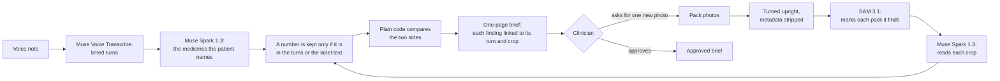

# Anamnesis

**What the patient says vs. what's on the pack.**

The patient sends a voice note and photos of their medicine packs. The clinician gets a one-page brief. [1.1] Every finding links back to the audio turn and the image region it came from. [1.3]

Built for the Meta Global AI Developer Hackathon. Tracks: Indie and Best Agentic Use-Case. [6.4]

Anamnesis is not a medical device and gives no medical advice. [1.15]

Numbers in brackets, such as [4.13], are rows of [`docs/CLAIMS.md`](docs/CLAIMS.md). Each row gives a claim's evidence by file and line, and the words the claim may use.

## Why
In a Lancet feasibility study, primary care doctors who read an AI pre-visit chat said it helped them prepare in 33 of 44 cases. But a chat can't see the pack. [6.2]

<sub>Brodeur PG et al. Conversational diagnostic artificial intelligence in ambulatory primary care: a prospective feasibility study. *Lancet* 2026;408(10565):1732–44. [doi:10.1016/S0140-6736(26)01535-7](https://doi.org/10.1016/S0140-6736%2826%2901535-7)</sub>

## How it works

<sub>The diagram restates rows 1.2, 1.3, 1.6, 1.13, 1.16, 2.1, 2.2 and 3.1.</sub>

- Muse Voice Transcribe turns the note into timed turns. SAM 3.1 marks each pack it finds. Muse Spark 1.3 picks the medicines out of the transcript and reads each label. [1.2]
- Before any model sees a photo, Anamnesis turns it upright and strips its metadata, GPS included. [3.1]
- The label reader only ever sees the crop of its own box. [1.6]
- A number a model writes is kept only if it appears in the patient's turns or in the label text the reader returned. [1.13]
- When a pack prints a strength per a volume, such as 250 mg per 5 ml, a reading keeps that strength only if the pack also prints it in the reading's own unit, such as per ml. Otherwise the strength is left empty. It is built to lose a strength rather than keep a wrong one, and its known exceptions are under Limitations. [1.19]
- Then plain code compares the two sides. No model decides a finding. [1.16]
- When the reader reports a label unreadable or partial, Anamnesis says so. [1.17] If a photo shows no pack, the brief says so. [1.12]
- Every product model call is logged with its cost, and each live intake has a call cap and a dollar cap. [3.5]

## The brief
- Disagreements come first, with what the patient said, as extracted, and the pack side by side. [1.7]
- Click a turn and you hear that turn, from its start to its end. [1.4] Click the box and you see the crop the label reader saw. [1.5]
- Every sentence Anamnesis adds is fixed text. It adds no advice of its own, and pack text is quoted as printed. [1.8]
- Panadol and Gelocatil are two brand names for one medicine. Anamnesis notes that both contain paracetamol, and that concurrent use is unconfirmed. [1.9] It also notes two medicines from one class, beta-blockers. Concurrent use is unconfirmed. [1.10]
- Only what the patient says counts as use. A photo of a pack never does. [1.11]
- The brief is one static page. It calls no model, and it refuses media the report wasn't made from. [1.14]
- Every brief ends with a collapsed "How it got here" table: one row per agent step, with its model, tokens, time and cost, and a total with the intake's calls and spend. [1.20]

## The clinician's pause
- If a label can't be read, the clinician can ask the patient for one new photo. Only that photo is processed, and the brief updates. The run pauses for a person, then resumes. [2.1]
- The brief stays a draft until the clinician approves it. [2.2]
- The code fixes the order. The clinician decides the pause. No model chooses an action. [2.3]
- The pause is built and tested offline. [2.1] There is no clinician app yet: the request is one function call, and in the demo the developer plays the clinician. [2.6]

## Results, as measured
Every run below predates batch 23. The synthetic notes ran on the code of 27 Oct, of batch 20 and of batch 21, the public photos on batch 20's and batch 21's, and the comparison on batch 22's. Batch 23's changes, the "package" concept and the volume rule, haven't been rerun on any of them. [4.1, 4.11, 4.13, 4.14, 1.19]

These are staged tests, not a validation. The expected results come first, and every run is reported as it came out, failures included. [4.15] No patient data: the pack photos are rendered test images or real public photos, the patients' histories are invented, and every voice so far is synthetic. [3.3]

### Ten public pack photos, before and after batch 21
The expected results were committed before the first run (8b993ff). [4.4] On the same ten pre-registered public-photo cases, with the same expected results, the code got 1 right before batch 21 and 3 after it. Neither run showed a false match, or a wrong strength or ingredient as fact. [4.11]

| Case | Expected | Before batch 21 | After batch 21 |
|---|---|---|---|
| U1 Concor, Russia (Cyrillic) | `match` | `insufficient_information` | `match` ✓ |
| U2 Augmentin, Belgium (French) | `match` | not paired | `insufficient_information`: the claim came back with no strength (fails safe) |
| U3 Panadol, Australia | `match` | `insufficient_information` | `match` ✓ |
| U4 Panadol 500 mg, Finland, two tablets | `intake_differs_from_unit_strength` | ✓ | ✓ |
| U5 Norvasc 5 mg and 10 mg, Israel | paired with the 5 mg box, `match` | paired with the 10 mg box | paired with the 10 mg box, `insufficient_information`: a wrong pairing |
| U6 Glucophage, China | `match` | `unresolved_name` | the same: the reader transcribed the manufacturer block (fails safe) |
| U7 Sortis 40 mg vs "Lipitor twenty milligrams" | `strength_mismatch` | `insufficient_information` | `unreadable_source`: the pack read as only partly readable (not harmful) |
| U8 Betaloc ZOK 100 | `match` | `unreadable_source` | the same: low resolution, the unit cut off (not harmful) |
| U9 Panadol Extra carton | `ingredient_mismatch` | no pack found | the same: SAM finds no pack in flat label artwork (fails safe) |
| U10 Panadol Extra Strength 500 | `match` | no pack found | the same (fails safe) |

- **U5 is still a miss.** The patient's Norvasc is paired with the 10 mg box instead of the 5 mg one, and the brief says it can't confirm agreement. [4.11] Before batch 21, the claim tied with both boxes and the tie went by id. Batch 21 lets the patient's stated dose break such a tie, but in its run the claim and the 5 mg box both came back without amounts, so the two boxes tied again. Spark still sometimes writes an amount as a word, and on batch 21's code that word was dropped. [4.11, 1.13]
- **U7 is a miss in both runs.** Its expected result was written wrong: it assumed the patient stated a strength, but Spark read "Lipitor twenty milligrams" as an intake. The expected result is kept as written. [4.11]
- These two runs are the scope of the "no false match" line. In the comparison below, Spark 1.3 showed a wrong strength as fact on 2 of 20 crops. [4.11]
- Every case, cause and cost: [`evidence/batches/21/live-after.md`](evidence/batches/21/live-after.md).

### Two synthetic voice notes
On two synthetic notes, one English and one Egyptian Arabic, 3 of 6 findings came out as expected before batch 21, and 6 of 6 after it. [4.12] On 27 Oct, with that day's code, all three findings came out right on both notes. [4.1]

| Note | Expected | 27 Oct | 28 Oct, before batch 21 | After batch 21 |
|---|---|---|---|---|
| English: Concor "five milligrams once a day" | `match` | ✓ | `insufficient_information` | ✓ |
| English: metoprolol 50 mg twice a day vs Beloc-Zok 100 mg | `intake_differs_from_unit_strength` | ✓ | ✓ | ✓ |
| English: Panadol, stopped | stopped | ✓ | ✓ | ✓ |
| Arabic: كونكور خمسة ملي جرام (Concor, five milligrams) | `match` | ✓ | `insufficient_information` | ✓ |
| Arabic: بيلوك زوك خمسين ملي جرام (Beloc-Zok, fifty milligrams) vs Beloc-Zok 100 mg | `intake_differs_from_unit_strength` | ✓ | `insufficient_information` | ✓ |
| Arabic: البنادول (Panadol), stopped | stopped | ✓ | ✓ | ✓ |

The three misses on 28 Oct came from the batch 20 prompt. Spark copied each dose spoken in words ("five") into the amount, the stated-amount rule dropped it, and every such case failed safe to `insufficient_information`. Batch 21 asks for digits. [1.13, 4.1]

### Cost and time
About 3 cents per intake (12 live intakes, 28 Oct). [4.2] One intake took 17 to 49 seconds (12 live intakes, 28 Oct). [4.9]

## Comparison: an open-weight label reader, zero-shot
Built with Muse Spark Open, for this comparison only. The product's label reader stays Muse Spark 1.3. [4.13]

In a pre-registered zero-shot comparison, SAM 3.1 found a pack in 20 of 39 public photos. On those 20 crops, Spark 1.3 read 14 correctly with 2 harmful readings, and Muse Spark Open on Baseten read 14 with 1. [4.13] Every reader read the same SAM 3.1 crops with the same prompt, schema and parser, and no model was trained. The photos are 30 Cairo University phone photos (CC BY 4.0) and 9 Wikimedia Commons photos. [4.13]

A descriptive comparison, n = 20, from one pass. Scored after the scorer fix below: [4.13]

| Reader | Correct | Harmful | Missed | Abstained | Error | Cost per read | Median time |
|---|---|---|---|---|---|---|---|
| Muse Spark 1.3 (Meta API) | 14 | 2 | 0 | 4 | 0 | $0.0094 | 7.4 s |
| Muse Spark Open on Baseten | 14 | 1 | 0 | 3 | 2 | $0.0136 | 15.4 s |
| Muse Spark Open on Fireworks, strict JSON mode | 1 | 1 | 10 | 8 | 0 | $0.0100 | 23.4 s |

- **Both scorings.** The scorer splits a combination's ingredients at "+", "/", "&", "and" and "with". Readers also wrote a comma, so the comma was added after the run, which moved four verdicts out of harmful. As run, the three rows were 13 / 3 / 0 / 4 / 0, 13 / 2 / 0 / 3 / 2 and 0 / 3 / 9 / 8 / 0. [4.13]
- **Every harmful reading:** [4.13]
  - Spark 1.3 read Janumet's metformin as 100 mg, where the pack prints 1000 mg. [4.13]
  - Spark 1.3 read a 250 mg/5 ml syrup as "250 mg per dose". [4.13]
  - Spark Open on Baseten read the same syrup as 250 mg per ml, a fivefold error. [4.13]
  - Spark Open on Fireworks put the placeholder "not_printed_in_visible_crop" in a reading's ingredient field. [4.13]
- **Why Fireworks scores low:** its strict JSON mode returned no strength on any crop, so that row measures the host's setting, not the open weights. [4.13]
- **Baseten's 2 errors** were length stops at the 4,000-token limit: no reading, charged, and failed safe. [4.13]
- **Diagnostics decided after the run, not scores:**
  - With JSON mode off, the same model on Fireworks read 5 of 5 crops that the other two readers had read correctly. [4.13]
  - Read again with an 8,000-token cap, Baseten's two length stops both came back correct. Both replies ended under the old 4,000-token cap, so this was a second draw, not a fix, and the table keeps both as errors. [4.13]
  - In a diagnostic after the run, not pre-registered, the concept "package" found a pack in all 19 photos where the first two concepts found none. With it, Spark 1.3 would have read 22 of the 30 Cairo phone photos correctly, not 7. Batch 23 added it to the loop. [4.14]
- The volume rule above was written for the two syrup readings, but the comparison wasn't rerun on it. [1.19, 4.13]
- Every photo, reader and verdict: [`evidence/batches/22/comparison.md`](evidence/batches/22/comparison.md).

## How it was built
- Muse Code wrote the product code for the last ten batches. [5.1] All product code in `anamnesis/` from batch 16 on was written by Muse Code. [5.3] The brief, its timeline, the photo request, the cross-medicine check and the volume rule are code Muse Code wrote. [5.2]
- Claude Code wrote the spec and the acceptance tests. Muse Code couldn't edit them, and an independent reviewer checked every Muse batch. [5.4]
- Batches 1–12 were built with GPT-6 Sol and Luna through Codex, some with Claude Code fixes, and batch 6 by hand. Batches 13–15.5 were built by Claude Sonnet subagents. [5.3]
- In batch 22, the independent reviewer caught a spec error: as briefed, "less than five milligrams" would have been read as exactly five and shown as a match. The contract now pins that case. [5.10]
- Batch 23 took nine rounds: the independent reviewer sent it back seven times before approving it. Before each round, Claude Code checked its own contract on a throwaway reference build. At the end, all 44 deliberate single-rule breaks of that reference were caught by the contract. Its follow-up, batch 23.1, passed review in one round with nothing to change. [5.11]
- Batches 1 to 20 were each specified, built, gated and reviewed in one day, 27 Oct. [5.8]
- Muse Code's sessions cost about $26.87 of Meta credit so far, priced from its own billing records (28 Oct). [5.5] About $28.71 of the $150 credit in logged calls so far (28 Oct). Muse grill runs are billed separately. [5.6]
- Each Muse batch's record is in `evidence/batches/<n>/`: `builder.md`, `gate.json`, `supervisor.md` and `review.md`. [5.1]

## Run the tests
1,932 tests run offline, with no keys. [5.7]

```bash
uv run pytest
```

## Limitations
- No outside usability check was done: it was declined for this submission. [4.8]
- Tested on synthetic voices only, in English and Egyptian Arabic. [3.3, 4.12]
- The same Arabic recording came back in three different spellings across runs. Curated Arabic brand names cover the ones seen so far. [4.3]
- Turns, not words: click a turn and you hear the whole turn. [1.4]
- The number check looks only at the number, not its unit, and doesn't check the regimen's counts. On the pack side it checks the label text the reader itself returned. Spanish number words aren't read, so such a dose is dropped. [1.13]
- Only one class is curated, beta-blockers, and interactions aren't checked. [1.10]
- SAM 3.1 doesn't always find the pack: in the comparison it found one in 20 of 39 public photos. [1.2, 4.13]
- The volume rule gives up some coverage on purpose, listed in SPEC §2, prefilled syringes and pens read per dose the main one. It doesn't read every syrup wording, and at least one wording still keeps a per-tablet reading on purpose: "Paracetamol 250 mg = one tablet in each 5 ml". [1.19]
- Every miss on the ten public photos and the two synthetic notes is in their two tables above. [4.11, 4.12]

## Data and privacy
- No patient data. The pack photos are rendered test images or real public photos, the patients' histories are invented, and every voice so far is synthetic. [3.3] The rules for real media are in [`docs/DATA_HANDLING.md`](docs/DATA_HANDLING.md).
- Every product call used Meta's standard models. [3.4]

## Built with
- **Meta models in the product:** Muse Voice Transcribe, SAM 3.1 and Muse Spark 1.3. [1.2]
- **Meta tooling in the build:** Muse Code. [5.1]
- **For the comparison only:** Muse Spark Open, on Baseten and on Fireworks. Those providers bill its reads, outside the Meta credit. [4.13, 5.6]

## Where things are
- [`SPEC.md`](SPEC.md): the contract.
- [`anamnesis/`](anamnesis/): the product code.
- [`tests/contract/`](tests/contract/): the acceptance tests. [5.4]
- [`evidence/`](evidence/): each batch's record, the live runs, the spend ledgers and the decisions.
- [`docs/CLAIMS.md`](docs/CLAIMS.md): every claim on this page, with its evidence.

By Ahmed Zayed, physician (MBBCh). [6.1]

<!-- Draft from docs/CLAIMS.md (judge/claims-video, 28 Oct). To add once each row lands, never before:
the hero's N of 10 (4.5) and its disagreement (4.10); Ahmed's real cases (4.6) and his voice (4.7, and 3.3's second
wording); the pause, live (2.5); one medicine under another brand name in another country (1.18); the Cairo set's full citation (§8); a hosted sample brief, once it
has a row (§7). An open-weight track only once decisions.md records Ahmed's call (6.4). -->
